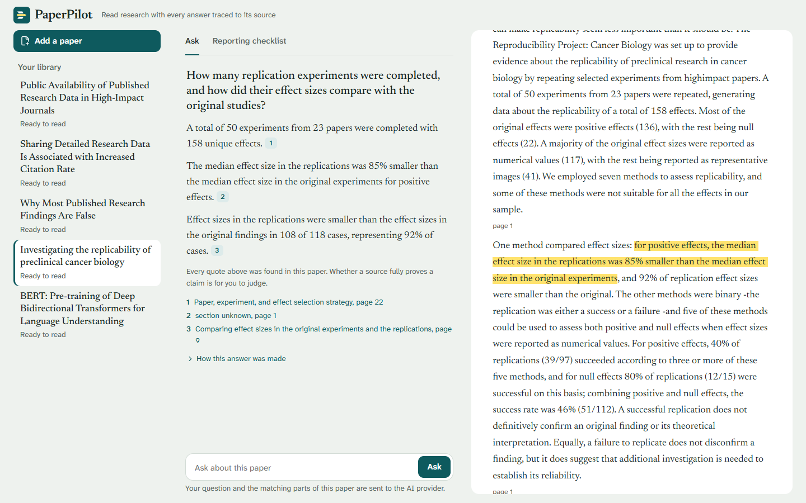
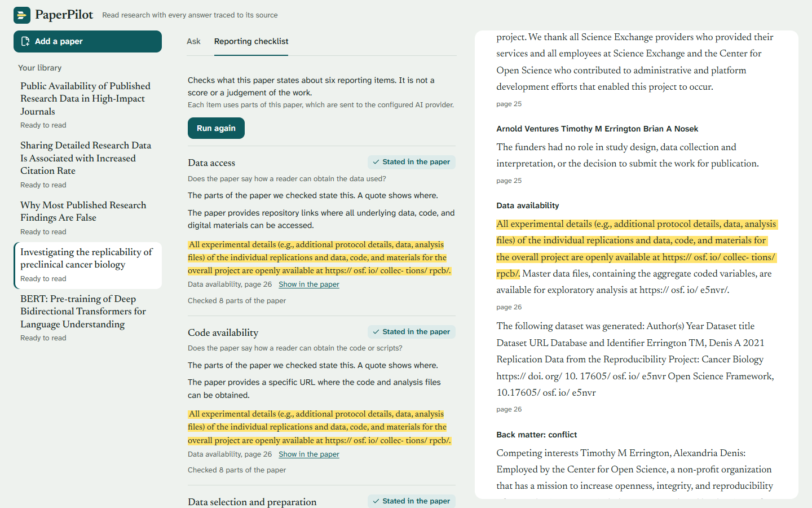
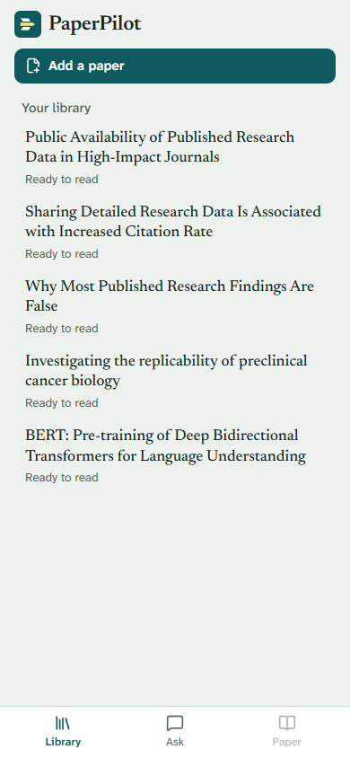
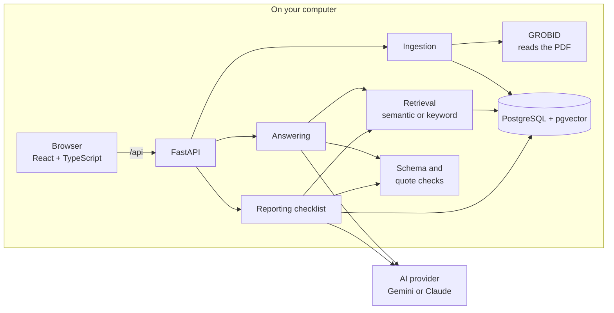

<p align="center">
  
</p>

<p align="center">
  <a href="https://github.com/rknishanth152-lgtm/paperpilot/actions/workflows/ci.yml"></a>
  <a href="LICENSE"></a>
</p>

PaperPilot reads academic papers and answers questions about them, and every sentence it gives you links to the exact passage it came from. Click a citation and the paper opens with the quoted words highlighted. A second view checks what a paper says about six things a reader needs to repeat the work, such as where the data and code are, and shows the quote for each.

It runs on your own computer. It is a student project, built step by step with tests and measured against a small labelled set of papers. The results and their limits are reported below as they came out.



<sub>The paper shown is Errington et al. (2021), "Investigating the replicability of preclinical cancer biology", *eLife* 10:e71601, [doi:10.7554/eLife.71601](https://doi.org/10.7554/eLife.71601), CC BY 4.0. Screenshot of PaperPilot running locally with Gemini 3.5 Flash-Lite on 2026-11-10.</sub>

## What it does

- **Answers with sources you can check.** You ask a question about one paper or several. PaperPilot finds the five most relevant passages, asks the model for an answer that quotes them, and then checks in code that every quote really appears in the passage it cites. An answer that fails the check is marked as failed, not shown as if it were fine.
- **Says when the paper does not answer.** If the passages found do not answer the question, you get "not enough evidence" rather than a guess.
- **Shows where each quote is.** Section and page come from the stored paper, never from the model. Selecting a source scrolls the paper to the quote and highlights it.
- **Reporting checklist.** For six items (data access, code availability, data preparation, analysis procedure, measures and comparisons, software environment) it shows whether the paper states them, with the quote. "Not found in the material examined" is never presented as a verdict on the paper, and a paper that could not be read fully gets "needs your review" instead.
- **Plain wording.** The interface avoids internal terms, keeps answers when you switch views, and works on a phone-sized screen.



<sub>Same paper and licence as above.</sub>

<details>
<summary>Phone-sized layout</summary>



</details>

## How it works



1. **Reading a paper.** An uploaded PDF is checked by its content, stored under a generated name, and sent to [GROBID](https://github.com/kermitt2/grobid), which splits it into sections. Each paragraph and caption becomes a stored **passage** with its section and page (the reference list is left out). Passages never change after they are stored, and an identical file uploaded twice is not stored twice.
2. **Finding passages.** By default each question is matched against passage embeddings (`gemini-embedding-2`, exact cosine search in pgvector). If some passages have no embedding yet, PostgreSQL full-text search is used instead, and the answer says which method was used.
3. **Answering.** The model sees the passages under short labels such as `S1`, `S2`, and must reply in a fixed JSON format. Code maps each label back to a stored passage, and marks the answer as failed if a label is unknown or a quote is not found in its passage. There is no agent loop.
4. **What is stored.** Source text and machine-generated results live in separate tables. Every checklist result records the passages it used and the model, prompt and checklist versions that produced it. Answers are not stored.

The backend is a single FastAPI application with separate modules for ingestion, retrieval, answering and the checklist. The design decisions and their reasons are in [`PRD.md`](PRD.md).

## Measured results

All figures come from saved runs in [`benchmarks/results/`](benchmarks/results/). The sets are small: 5 open-access papers, 20 questions (16 answerable, 4 not) and 18 checklist items, labelled by one person, the developer. Read them as a check that the system behaves as designed, not as general accuracy.

| What was measured | Result | Report |
|---|---|---|
| Expected passage among the top 5 retrieved, semantic search | 16 of 16 (keyword search: 8 of 16) | [Retrieval comparison](docs/experiments/retrieval-comparison.md) |
| Answerable questions answered with every citation passing validation | 16 of 16, latest run (2026-11-10) | [Retrieval comparison](docs/experiments/retrieval-comparison.md) |
| Citations whose quote was found in the cited passage | 29 of 29, latest run | same run |
| Unanswerable questions correctly refused | 4 of 4, latest run | same run |
| Statements supported by their cited passages, as judged by the labeller | 20 of 20 (keyword-search answers) | [Baseline report](docs/experiments/vs1-baseline-report.md) |
| Statements that fully answer the question | 12 of 20 | [Baseline report](docs/experiments/vs1-baseline-report.md) |
| Checklist items agreeing with the labels | 15 of 18; always answering "stated" would get 16 of 18 | [Checklist baseline](docs/experiments/reproducibility-baseline.md) |

Some of these need reading with care:

- **16 of 16 for semantic search is on questions written against these same papers.** It shows that keyword search was failing on vocabulary. It does not show that semantic search will find the right passage on any paper.
- **A passing citation check proves the quote exists, not that it supports the sentence.** Whether a passage supports a statement was judged by hand on 20 statements, one labeller, with three labels revised after seeing the first results. Both sets of labels are kept and reported.
- **The checklist does not beat the simplest guess.** Its disagreements were all cautious: every item it marked "stated" was labelled "stated", and it never claimed more than the labeller did.

Engineering checks, run on every push by [CI](.github/workflows/ci.yml): 1,191 backend tests (696 unit, 495 against real PostgreSQL and GROBID containers), 72 frontend tests, ruff, mypy, migration checks, a production build and `npm audit`. `pip-audit` found no known vulnerabilities in the Python packages when run for the [release review](docs/reviews/release-review.md). Rules about evidence, validation and statuses were also checked by deliberately breaking the code and confirming a test fails. Accessibility was checked with axe-core (WCAG 2.2 AA) with no violations on the screens tested, along with keyboard-only use and reduced-motion settings.

## Known limitations

- **Local and single-user only.** There is no sign-in. Do not put it on a shared or public network.
- **Small evaluation.** Five papers, one labeller, one model family (Gemini). Results may differ on other papers, fields or models. The Claude provider is implemented and unit-tested but was not used for the measured runs.
- **Reading PDFs is imperfect.** Text is shown exactly as GROBID extracted it, including joined words, stray figure text and broken equations. Section titles can be missing or wrong.
- **New papers are not embedded automatically.** Until you run the embedding script, questions on them use keyword search, which found the right passage less often.
- **Support is not checked automatically.** The interface tells you every quote was found, and asks you to judge whether the source fully proves the sentence.
- **Text leaves your computer when you ask.** Questions, the passages found and checklist inputs are sent to the AI provider you configure. On Gemini's free tier, Google may use that content and people may read it, so use it only with open-access papers.
- **Not built yet:** extracting datasets and metrics, searching for papers online, and comparing papers side by side. These are planned after v1.0 ([roadmap](docs/implementation-roadmap.md)).
- **Not tested:** use with a real screen reader, and a first-time setup on a machine without Docker images and package caches already downloaded.

## Quick start

You need Docker Desktop, Git, Node.js 24, and [uv](https://docs.astral.sh/uv/). The full guide, with every check and the API reference, is in [`docs/getting-started.md`](docs/getting-started.md).

```bash
git clone https://github.com/rknishanth152-lgtm/paperpilot.git
cd paperpilot
cp .env.example .env          # then set POSTGRES_PASSWORD, and LLM_API_KEY to ask questions
uv sync
docker compose up -d --wait   # PostgreSQL and GROBID, on this computer only
uv run alembic upgrade head
uv run uvicorn app.main:app --app-dir backend --host 127.0.0.1 --port 8000
```

In a second terminal:

```bash
cd frontend
npm ci
cp .env.example .env
npm run dev
```

Open <http://127.0.0.1:5173> and add a PDF. Uploading and reading papers works without an AI key; asking questions and running the checklist need one. A free Gemini key works ([setup](docs/getting-started.md#connecting-an-ai-model)).

## Built with

| Part | Tools |
|---|---|
| Backend | Python 3.14, FastAPI, Pydantic, SQLAlchemy, Alembic |
| Storage | PostgreSQL 18, pgvector |
| PDF reading | GROBID 0.9.1 |
| AI | Gemini 3.5 Flash-Lite and `gemini-embedding-2` by default; Anthropic Claude supported |
| Frontend | React, TypeScript, Vite, React Aria Components, react-resizable-panels, Lucide icons |
| Checks | pytest, ruff, mypy, Vitest, Testing Library, GitHub Actions; axe-core and Playwright for manual browser checks |

## How this was built

PaperPilot was built by a student with Claude Code as a learning project, one small task at a time. Each task started from a written requirement, had its tests written first, and was recorded in [`progress.md`](progress.md) only after it was checked.

| Document | What it holds |
|---|---|
| [`PRD.md`](PRD.md) | Requirements, design decisions and open questions |
| [`docs/implementation-roadmap.md`](docs/implementation-roadmap.md) | Phases, tasks and exit criteria |
| [`progress.md`](progress.md) | What is done and how it was verified |
| [`docs/getting-started.md`](docs/getting-started.md) | Setup, commands and API |
| [`docs/experiments/`](docs/experiments/) | Evaluation reports |
| [`docs/reviews/release-review.md`](docs/reviews/release-review.md) | Security, privacy and licence review |
| [`docs/design-system.md`](docs/design-system.md) | Colours, type and motion |
| [`CLAUDE.md`](CLAUDE.md) | Working rules for development with Claude Code |

## Licence

MIT, see [`LICENSE`](LICENSE). No papers are included in this repository. Only upload papers you are allowed to use, including sending their text to the AI provider you configure.
